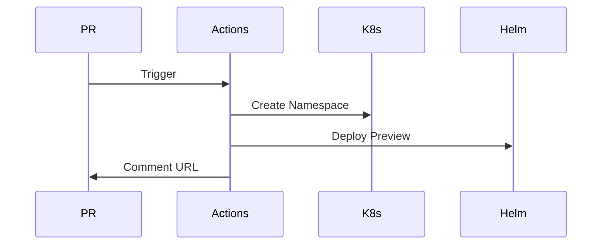
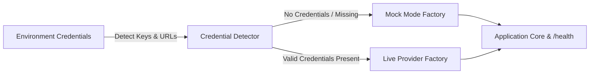

# Architecture: Ephemeral Preview Environments
> Maturity: Lab / Reference Implementation

## System Diagram
The following Mermaid.js sequence diagram maps the core workflow and interactions:

## Core Lifecycle
1. **Trigger**: The GitHub Action is hooked to `pull_request` events (`opened`, `synchronize`, `closed`).
2. **Isolation**: K8s Namespaces are cheap. By dynamically creating a namespace formatted as `pr-<number>`, we ensure complete isolation from other PRs.
3. **Routing**: An Ingress resource is dynamically templated with the URL `pr-<number>.preview.domain.com`. ExternalDNS (running in the cluster) detects the new Ingress and automatically creates a Route53/Azure DNS record.
4. **Cleanup**: When the PR is closed (whether merged or abandoned), the `preview-env-down` workflow deletes the namespace. Kubernetes garbage collection automatically destroys all pods, services, and ingresses within it.

## The Database Problem
The hardest part of ephemeral environments is data. Connecting a PR environment to the Staging database is dangerous (schema migrations could break Staging for everyone).
Instead, we deploy a lightweight, empty database container (via the Bitnami Postgres Helm chart) directly into the PR namespace. The application must run its schema migrations (e.g., Flyway/Liquibase) on startup to initialize the empty database.

## Progressive Credential Loading & Production Architecture (v0.2.0)

This service implements the **Progressive Credential Loading (PCL)** pattern, decoupling development speed from external infrastructure provisioning:

### Core Architecture Components
1. **Mode Detection Singleton:** Inspects environment configuration at boot time without hard crashes on missing secrets.
2. **Dual-Mode Factory Wrappers:**
   - **Storage / Cache:** In-process maps or SQLite `:memory:` transparently promote to managed Redis or PostgreSQL when connection strings are supplied.
   - **AI Providers:** Deterministic heuristic generators and local embeddings transparently promote to live OpenAI, Anthropic, or Gemini API clients.
3. **Hot-Reload & Dynamic TLS:** File watchers monitor mounted volume paths (Kubernetes ConfigMaps and Secrets) to update certificates and limit configs atomically without process restarts.
4. **Health & Observability:** The `/health` endpoint exposes real-time runtime mode metadata (`mock` vs `live`) across all backing adapters.
